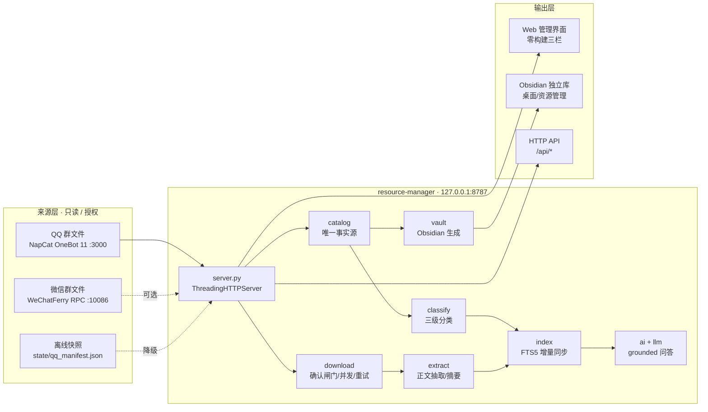

<div align="center">

# Resource Manager

**把 QQ / 微信群里散落的课程资料，整理成一个可检索、可问答的本地 Obsidian 知识库**

`群文件采集` · `三级自动分类` · `微信监听式收集` · `SQLite FTS5 全文检索` · `AI 防臆造问答` · `Obsidian 多级大纲` · `零第三方硬依赖`

[](https://www.python.org/)
[](requirements.txt)
[](lib/index.py)
[](lib/vault.py)
[](#-安全与隐私)
[](docs/CHANGELOG.md)

</div>

---

> [!IMPORTANT]
> **这是一个纯本地、只读、授权范围受限的个人资料整理工具。**
> - 服务**只监听 `127.0.0.1`**，不对外暴露；所有资料、索引、密钥都留在本机。
> - 对 QQ / 微信云端**只读 / 只监听**，不修改群内任何内容，**绝不读取加密聊天数据库**。
> - 下载必须经过界面**显式确认**；未下载条目只有文件名与元数据，AI 不会推测其内容。
> - 微信能力依赖第三方 [WeChatFerry](https://github.com/lich0821/WeChatFerry)，**默认关闭**；使用前请自行确认符合平台规则与当地法律。

---

## 项目简介

课程资料散落在十几个 QQ 群、微信群的层级目录里：找一份「复变函数期末真题」要翻遍群文件，下下来又散在桌面各处，更没法按科目检索或针对内容提问。

**Resource Manager** 用一条完整闭环解决这件事：

> **来源盘点 → 自动分类 → 逐级下钻 → 确认下载 → 正文入库 → 全文索引 → Obsidian 大纲 → AI 检索问答**

- **零第三方硬依赖**：核心链路全部 Python 标准库（`http.server` + `sqlite3` FTS5 + `urllib`），克隆后**不用 `pip install` 就能跑**。
- **未下载也能检索**：所有条目先进目录与索引，AI 可以基于「可见的元数据」回答「有哪些 / 多少 / 哪些还没下载」，但明确标注「仅元数据，无正文摘要」，绝不把文件名当内容。
- **本地模型或外部 API 都行**：默认指向本机推理服务（Bonsai2，自动 `disable_thinking`），也可切任意 OpenAI 兼容接口；模型挂了自动降级为纯本地检索，不编造答案。
- **Obsidian 独立新库**：自动在桌面生成 `资源管理/` 独立 Obsidian 库（带多级大纲 MOC 与 AI 侧边栏插件），**不碰你原有的任何笔记库**。

实测数据：3 个 QQ 群、1641 条原始清单去重后 **1625 条 / 约 12.73 GB**，覆盖 6 个领域、23 个具体科目、6 类资源。

---

## 核心能力

| 能力 | 说明 |
| --- | --- |
| 📥 **QQ 群文件只读盘点** | 通过本机 NapCat（OneBot 11）`get_group_root_files` + `get_group_files_by_folder` **递归遍历全部目录**，只取元数据；接口掉线自动收紧为「离线快照」并锁定下载，恢复在线需用户显式点「刷新来源」 |
| 🧠 **群文件三级自动分类** | `领域 → 科目/主题 → 资源类型` 三层归类，词库全部在 `config.json`（6 领域 / 23 科目 / 6 类型），按「文件夹名权重 > 文件名权重」打分，可自由增删；详见 [群文件自动分类](#-群文件自动分类) |
| 💬 **微信群文件监听采集** | 基于 GitHub 成熟方案 **WeChatFerry** 的监听式适配器，只接收你**指定群**内的文件/附件消息，5 秒防抖并入目录；默认关闭、绝不读加密库；详见 [微信监听与收集](#-微信监听与收集) |
| 🔍 **SQLite FTS5 全文检索** | trigram 分词 + 可选 `jieba` 中文分词；命中判定与答案生成**解耦**——模型只负责概括，不负责判断「有没有」；支持按当前浏览范围限定检索，避免「问高数却答复变」 |
| 🤖 **AI 防臆造问答** | 未命中直接如实回答、不调模型；「有哪些/多少/未下载」走目录确定性统计；已下载条目可概括正文，未下载条目强制标注「仅元数据」；来源索引可点击回跳 |
| 📚 **Obsidian 同步** | 自动生成 `00-资源总览`、全量多级大纲、每个层级一页 MOC、单文件预览笔记；所有生成笔记带 `NOTE_MARK`，重建时只删带标记的，**不碰手工笔记** |
| 🖥️ **零构建 Web 界面** | 三栏布局、分类树逐级下钻、全文搜索 + 命中高亮、类型筛选、单文件预览、AI 对话、系统诊断面板；原生 HTML/CSS/JS，无打包步骤 |
| 🔐 **下载确认闸门** | `confirm=true` + 显式 `ids` 才放行；整类下载需原样输入节点名；单批上限默认 30；离线快照拒绝下载；扩展名白名单校验；服务端二次校验，前端不可绕过 |
| ⚡ **增量索引与并发下载** | `index.sync()` 用「元数据指纹 + 正文 stat」两阶段比对，未变化条目完全跳过；下载单批内并发拉取、失败指数退避重试、`file_id` 失效不重试 |
| 🩺 **启动自检与诊断** | 启动时校验 `config.json`（群号/白名单/端口/AI 配置）并打印可读清单；`GET /api/diagnose` 与界面「系统诊断」按钮随时查看状态 |
| 📦 **双击即用的安装器** | `resource-manager-installer.bat` 自解压全程序（base64 内嵌），无需 Python 环境配置即可解压启动；新手向导 2 步完成 NapCat + 群号配置 |

---

## 🎯 群文件自动分类

群文件往往只有文件名和所在文件夹可用。分类器（`lib/classify.py`）按**可解释的加权打分**做三级归类，规则全部外置在 `config.json`，改词库不用改代码：

| 层级 | 取值来源 | 打分规则 |
| --- | --- | --- |
| **领域** `domain` | 6 个领域词库（学习 / 考试与复习 / 科研与论文 / 证书与竞赛 / 实习与就业 / 生活与办事） | `2 × 文件夹命中数 + 1 × 文件名命中数`；均未命中时若已识别出科目或属于课件/习题/笔记，则兜底为「学习」 |
| **科目** `subject` | 23 个科目词库（高等数学、复变函数与积分变换、高等代数、数据结构、C语言程序设计…） | `3 × 文件夹命中数 + 2 × 文件名命中数`，取最高分；无命中兜底「综合」 |
| **类型** `kind` | 6 类资源（试卷与解析 / 习题作业 / 课件资源 / 上课笔记 / 实验代码 / 指南说明） | `2 × 文件夹命中数 + 1 × 文件名命中数`，取最高分；无命中兜底「其他资料」 |

**为什么文件夹权重更高？** 群里通常已按「考试与复习 / 课件 / 作业」分好目录，文件夹名比文件名更可信；文件名只用来在同目录内区分科目与具体类型。

<details>
<summary><b>分类结果如何被使用</b>（点击展开）</summary>

- **左侧分类树**：`GET /api/tree?dim=classify` 按 `领域 → 科目 → 类型` 逐级聚合，显示每层份数 / 已下载数 / 体积；`dim=source` 可切到 `来源 → 群 → 文件夹` 视角。
- **检索范围**：AI 问答会先识别问题里的科目 / 领域 / 类型，并与当前浏览路径合并成过滤器，**严格只在范围内检索**。
- **Obsidian 大纲**：`vault.build_outlines()` 按三级分类生成总览、全量大纲与每个节点一页 MOC。
- **结果幂等**：`catalog.upsert_manifest()` 每次刷新重新计算分类，但保留已有的 `downloaded / note / asset / summary` 状态。

</details>

> 词库可按自己的课程表调整：`config.json → classification` 的 `domains / subjects / kinds`，改完点「刷新来源」重新归类即可。`tools/version_audit.py` 会拿 6 个代表性文件名回归验证分类词库是否失效。

---

## 💬 微信监听与收集

> [!WARNING]
> 个人微信**没有**「列出群文件全目录」的开放接口，也无法像 QQ 那样通过 OneBot 拉取云端群文件；聊天数据库是加密的。本项目**不破解、不读取**任何聊天记录。

因此微信侧采用**监听式采集**：借助 GitHub 上成熟的 [WeChatFerry](https://github.com/lich0821/WeChatFerry)（`wcferry`）方案，它在本机对「微信 3.9.x」进程暴露本地 RPC。本项目只订阅**你指定群**里出现的「文件 / 附件」消息，拿到文件名、体积、发送者、时间等元数据后并入统一目录。

| 环节 | 行为 |
| --- | --- |
| **启用前提** | ① `config.json → sources.wechat.wcf.enabled = true`；② 自行安装并运行 WeChatFerry 客户端 + 已登录的微信 3.9.x；③ `pip install wcferry` |
| **群白名单** | 必须显式指定监听群（wxid 列表）。`GET /api/wechat/wcf/rooms` 发现群、`POST /api/wechat/wcf/rooms/save` 保存到 `state/wechat_rooms.json`；**清单为空时明确报错，绝不监听全部群** |
| **采集流程** | `POST /api/wechat/wcf/capture/start` → 解析 appmsg XML 中的 `<type>` 过滤出文件/附件 → 5 秒防抖缓冲 → `catalog.upsert_manifest()` → `index.sync()` 增量索引 → `vault.build_outlines()` |
| **停止** | `POST /api/wechat/wcf/capture/stop`；`GET /api/wechat/wcf/status` 随时查看 enabled / available / login / capturing |
| **降级** | 未装 `wcferry` 或客户端未登录时，`status` 给出明确指引，微信源不可用但**其余功能完全不受影响** |

**启用步骤**

```bash
# 1. 安装可选依赖（其余功能不需要它）
pip install wcferry

# 2. 启动 WeChatFerry 客户端 + 登录微信 3.9.x（默认 RPC 127.0.0.1:10086）

# 3. 编辑 config.json：把 sources.wechat.wcf.enabled 设为 true

# 4. 启动服务，在界面或 API 中指定监听群并开始捕获
python server.py
curl -s http://127.0.0.1:8787/api/wechat/wcf/rooms
curl -s -X POST http://127.0.0.1:8787/api/wechat/wcf/rooms/save \
     -H "Content-Type: application/json" -d '{"rooms":["wxid_xxx"]}'
curl -s -X POST http://127.0.0.1:8787/api/wechat/wcf/capture/start \
     -H "Content-Type: application/json" -d '{"rooms":["wxid_xxx"]}'
```

> 采集到的同样是**元数据**；要拿到正文仍需像 QQ 文件一样在界面里显式确认下载（微信附件由 WeChatFerry 侧落地）。未监听到的历史群文件不会被凭空补出来——这是方案边界，不是 bug。

---

## 架构总览



**分层**：`web/ + obsidian_plugin/` → `server.py` → `catalog / classify / download / ai` → `qq / wechat_wcf / extract / vault / index / llm` → `state/`。

**核心数据流**：`来源刷新 → 归类 → 选择 → 下载 → 抽取 → 增量索引 → Obsidian 大纲 → AI 检索问答`。

---

## 快速开始

### 环境要求

- Python **3.13+**（核心链路零第三方依赖）
- QQ 群文件功能：本机已部署并登录 [NapCat](https://github.com/NapCatQQ/NapCatQQ)（OneBot 11 HTTP，默认 `:3000`）
- 微信功能（可选）：WeChatFerry + 微信 3.9.x
- Obsidian（可选，用于阅读生成的知识库）

### 方式一：自解压安装器（推荐给最终用户）

```text
1. 双击 resource-manager-installer.bat
2. 默认解压到同目录 resource-manager/ 并自动启动服务
3. 浏览器打开 http://127.0.0.1:8787
```

可选环境变量：`RM_INSTALL_TARGET`（指定解压目录）、`RM_NO_LAUNCH=1`（只解压不启动）。
首次使用会弹出「首次配置」向导：装 NapCat → 勾选/填写 QQ 群 → 完成。

### 方式二：源码运行（开发者）

```bash
# 1. 克隆
git clone https://github.com/ericzou090124/ericzou-01.git
cd ericzou-01

# 2.（可选）装中文分词，提升检索精度；不装自动回退 3-gram
pip install -r requirements-optional.txt

# 3. 启动（首次会刷新来源、建索引）
python server.py

# 4. 打开界面
#    http://127.0.0.1:8787
```

### 方式三：只跑验证（不启动服务）

```bash
python tools/smoke_test.py        # 16 项单元 + HTTP 集成回归，退出码 0 即通过
python tools/bench.py             # 索引 rebuild / sync / optimize 微基准
python tools/version_audit.py     # 全版本可用性审计，生成 docs/VERSION_AUDIT.md
```

### 可选依赖

| 包 | 用途 | 不装会怎样 |
| --- | --- | --- |
| `jieba` | 中文分词，检索词更精准 | 自动回退滑动 3-gram，功能不受影响；`RM_NO_JIEBA=1` 可强制关闭 |
| `wcferry` | 微信群文件监听采集 | 微信源不可用，其余功能不受影响 |
| `pymupdf` | PDF 正文抽取 | PDF 只登记元数据，标记「扫描件需 OCR」 |

---

## 配置说明

`config.json` 是唯一配置文件；运行时设置（模型、密钥）覆盖写在 `state/settings.json` / `state/secrets.json`，**均已 gitignore**。

| 字段 | 默认 | 说明 |
| --- | --- | --- |
| `vault` | `""` | Obsidian 库路径；空则回退 `~/Desktop/资源管理`（独立新库，不动原有笔记） |
| `host` / `port` | `127.0.0.1` / `8787` | 仅监听回环；改成非回环地址启动自检会给出告警 |
| `sources.qq.enabled` / `.groups` | `true` / 3 个示例群 | 群代号 → `{display, qq_group}`；群号必须是纯数字 |
| `sources.wechat.wcf.enabled` | `false` | 微信监听总开关，**默认关闭** |
| `sources.wechat.wcf.host/port` | `127.0.0.1:10086` | WeChatFerry RPC 地址 |
| `classification` | 6 领域 / 23 科目 / 6 类型 | 三级分类词库，可自由增删 |
| `allowed_ext` | 17 种 | 下载白名单（带点，如 `.pdf`）；为空时所有下载被拒绝 |
| `max_download_per_batch` | `30` | 单批下载上限，超出部分需再次确认 |
| `max_chars_per_file` | `60000` | 单文件入索引的正文截断长度 |
| `ai.provider` | `local` | `local` 或 `openai`（任意 OpenAI 兼容接口） |
| `ai.local.*` | `127.0.0.1:8080/v1` | 本地推理服务地址、模型名、`disable_thinking`（Bonsai2 需 `true`） |
| `ai.min_relevance` / `top_k` | `0.22` / `5` | 命中阈值与送入模型的最大片段数 |
| `RM_DOWNLOAD_WORKERS` | `4`（环境变量） | 单批并发下载线程数，设 `1` 强制串行 |
| `RM_DOWNLOAD_RETRIES` | `3`（环境变量） | 瞬时失败退避重试次数（0.5s / 1s / 2s） |
| `RM_NO_JIEBA` | 未设（环境变量） | 设为 `1` 禁用 jieba 分词 |

启动时 `lib/config_validate.py` 会校验全部关键项，把问题打印成可读清单；运行中可随时点界面「系统诊断」或请求 `GET /api/diagnose` 查看。

---

## 核心行为语义

### 下载闸门（不可绕过）

| 条件 | 服务端行为 |
| --- | --- |
| `confirm != true` 或 `ids` 为空 | 拒绝，返回明确原因 |
| 整类下载 `confirmText` ≠ 节点名 | 拒绝，要求原样输入 |
| 当前为离线快照 | 拒绝，提示先「刷新来源」切回在线 |
| 超出 `max_download_per_batch` | 只处理上限内条目，返回 `skipped_over_cap`，需再次确认剩余 |
| 扩展名不在 `allowed_ext` | 单条失败，不影响同批其它条目 |
| `file_id` 失效 / 直链为空 | 判定为**永久错误**，不重试，提示刷新来源 |
| 网络抖动 / OneBot 超时 / 空文件 | 判定为**瞬时错误**，指数退避重试至 `RM_DOWNLOAD_RETRIES` |

下载成功后 `catalog.save()` → `index.sync()` → `vault.build_outlines()`，均为增量/最小写入，不做全量重建。

### AI 防臆造

- **命中判定与生成解耦**：先本地检索，未命中直接返回「授权可见的资料中没有检索到相关信息」，**不调用模型**。
- **范围优先**：问题中的科目 / 领域 / 类型识别结果，与当前浏览路径合并成过滤器，检索严格限定在范围内。
- **未下载标注**：未下载条目在上下文与回答中必须写「仅元数据，未下载，无正文摘要」，不得描述文件内容。
- **模型降级**：`llm.chat()` 对超时 / 连接中断 / 5xx 指数退避重试；本地地址直连、外部地址走环境代理；模型返回「未找到」或不可用时自动改用本地原文摘录，不虚构。

### 索引增量同步

`index.sync()` 为每个条目维护 `(csig, bstat)` 两个指纹：`csig` 是元数据哈希（O(1)，无磁盘 I/O），`bstat` 是正文文件 `size:mtime_ns`。两者都命中即整条跳过；只有正文变化才重读。实测 `sync(无变化) ≈ 1503ms` vs `rebuild ≈ 2596ms`；`POST /api/maintain` 的 `ANALYZE + VACUUM` 可回收约 774KB 空闲页。

---

## 🖥️ Web 管理界面

`http://127.0.0.1:8787` · 三栏布局 · 明暗主题自适应 · 无构建步骤

| 区域 | 内容 |
| --- | --- |
| **顶栏** | 面包屑、统一搜索框（命中高亮 +「问 AI」）、AI 助手、设置、QQ 登录、首次配置、刷新来源、**系统诊断** |
| **左栏** | 授权来源状态（QQ 在线 / 离线快照、微信状态与限制说明）、分类大纲树（按分类 / 按来源切换）、统计卡 |
| **中栏** | 当前节点、全选本页 / 下载已选 / 整类下载、子级下钻、类型筛选条、文件列表（预览 / 下载 / 状态标签） |
| **右栏** | 单文件预览（元数据 / 摘要 / 正文片段 / 资产与笔记路径）、AI 助手（快速模式、范围显示、可点击来源索引、快捷提问） |

**系统诊断面板**：一键展示配置状态、错误清单、提醒清单、来源模式、QQ 在线状态、索引篇数与 Obsidian 库路径。

---

## 🔌 API 端点

服务仅监听 `127.0.0.1:8787`，无需鉴权（本地回环）。全部返回 JSON。

<details>
<summary><b>状态与目录</b></summary>

| 端点 | 方法 | 说明 |
| --- | --- | --- |
| `/api/health` | GET | `ok` / 索引篇数 / 来源模式 / QQ 在线状态 |
| `/api/diagnose` | GET | 配置自检 + 错误/提醒 + 运行态 |
| `/api/state` | GET | 完整状态：来源、统计、微信、设置、下载上限 |
| `/api/tree` | GET | 分类/来源树子节点（份数、已下载数、体积） |
| `/api/files` | GET | 节点内文件列表，支持 `q` 搜索、`kind` 筛选、`limit`，返回 `total` |
| `/api/file` | GET | 单文件详情 + 正文摘录 + 资产/笔记绝对路径 |
| `/api/outline` | GET | Obsidian 大纲信息 |
| `/api/ask` | GET / POST | AI 问答（支持 `fast`、`scope`） |

</details>

<details>
<summary><b>下载与维护</b></summary>

| 端点 | 方法 | 说明 |
| --- | --- | --- |
| `/api/download` | POST | 下载闸门；需 `confirm` + `ids`（+整类 `confirmText` / `nodeName`） |
| `/api/refresh` | POST | 只读刷新来源元数据，增量同步索引，不下载任何文件 |
| `/api/reindex` | POST | 强制全量重建索引 |
| `/api/maintain` | POST | `ANALYZE + VACUUM`，返回维护前后体积 |
| `/api/settings` | GET / POST | 读取 / 保存 AI 设置（密钥不回显） |
| `/api/settings/test` | POST | 测试模型连通性 |
| `/api/init` | POST | 初始化 Obsidian 库骨架 |

</details>

<details>
<summary><b>QQ 登录 / NapCat / 微信 / 新手向导</b></summary>

| 端点 | 方法 | 说明 |
| --- | --- | --- |
| `/api/qqlogin/status` · `/refresh` · `/quick` · `/restore` | GET / POST | 二维码登录状态、刷新二维码、免扫码快登、扫码后恢复在线 |
| `/api/napcat/status` · `/start` | GET / POST | NapCat 运行状态 / 拉起服务 |
| `/api/qq/groups` | GET | 列出本机 QQ 已加入的群 |
| `/api/wechat/wcf/status` | GET | 微信适配器状态（enabled / available / login / capturing） |
| `/api/wechat/wcf/rooms` · `/rooms/save` | GET / POST | 发现群 / 保存监听群清单 |
| `/api/wechat/wcf/capture/start` · `/stop` | POST | 开始 / 停止微信监听采集 |
| `/api/setup` · `/setup/config` · `/setup/done` | GET / POST | 首次配置向导状态、保存群配置、标记完成 |

</details>

---

## 版本、回归与开发者日志

本仓库按版本持续迭代，**每个版本都有独立 git tag 与 GitHub Release**，可随时 `git checkout vX.Y.Z` 回溯。

| 里程碑 | 内容 |
| --- | --- |
| `v1.0.0` ~ `v1.2.3` | 首次交付闭环、QQ 网页一键登录、零配置新手向导与安装器 |
| `v1.3.0` | 仓库基线审查（`REVIEW.md`）与自解压安装器 |
| `v1.4.0` | 检索精度与运行期开销优化（jieba 分词 / 缓存） |
| `v1.5.0` | **GitHub WeChatFerry 微信监听式适配器**（本项目首个外部成熟方案集成） |
| `v1.6.0` ~ `v1.8.0` | 索引增量同步、回归自测、刷新链路改走 `sync` |
| `v1.9.0` | 微信监听群清单持久化 + 群发现/保存端点 |
| `v2.0.0` ~ `v2.3.0` | 前端统一搜索框与高亮、索引维护/基准、下载并发与增量、AI 退化路径修复 |
| `v2.4.0` ~ `v2.7.0` | 配置自检与诊断端点、下载重试退避、系统诊断面板、HTTP 集成自测 |
| `v2.8.0` | 主页重写、全版本可用性审计、历史补丁标签、文档与 Release 治理 |

### 全版本可用性审计

`tools/version_audit.py` 会把**每个 tag** 检出到隔离临时目录，执行：归档完整性 / 配置解析 / 全量编译 / 模块导入 / 核心链路 / 群文件分类 / 微信适配器 / 路由完整性 / 前端语法 / 自带自测 —— 全程使用独立 `state/`，不碰真实资料。

```bash
python tools/version_audit.py                    # 全部 tag → docs/VERSION_AUDIT.md
python tools/version_audit.py --tags v2.7.0      # 指定版本
```

审计发现 `v1.3.0` ~ `v1.6.0` 的空问题 `NameError`（已在 v1.7.0 修复）。为保留历史原貌，**不改写原 tag**，而是用 `tools/fix_legacy_tag.py` 生成只含最小修复的补丁标签 `v1.3.0-p1` … `v1.6.0-p1`，全部通过检测。详见 [全版本审计报告](docs/VERSION_AUDIT.md)。

### 开发者日志

| 想看什么 | 读哪个文件 |
| --- | --- |
| 逐版本变更摘要 | [docs/CHANGELOG.md](docs/CHANGELOG.md) |
| **按时间顺序的开发日志**（每次决策、故障、修复、实测数据） | [docs/DEVLOG.md](docs/DEVLOG.md) |
| 系统审查、瓶颈排序与优化路线图 | [docs/REVIEW.md](docs/REVIEW.md) |
| 整体设计 / 模块划分 / 数据流 | [docs/DESIGN.md](docs/DESIGN.md) · [docs/ARCHITECTURE.md](docs/ARCHITECTURE.md) |
| 通读式说明文字（背景、使用旅程、隐私） | [docs/GUIDE.md](docs/GUIDE.md) |
| 本地试跑逐项结果、耗时、已知限制 | [docs/VERIFICATION.md](docs/VERIFICATION.md) |
| 存档说明与逐项验收清单 | [docs/RELEASE.md](docs/RELEASE.md) |
| 文档总索引 | [docs/README.md](docs/README.md) |

---

## 常见问题

<details>
<summary><b>主界面显示「离线快照」，下载按钮用不了？</b></summary>

NapCat / OneBot 没在运行或运行中途掉线。点顶栏「QQ 登录」或「刷新来源」；登录页与离线提示都有「启动 NapCat」按钮，点一下会拉起 NapCat 并等待 WebUI 就绪。也可手动打开 `http://127.0.0.1:6099/webui` 登录后回主界面刷新。**恢复在线必须用户显式操作**，避免拿失效 `file_id` 下载。

</details>

<details>
<summary><b>为什么微信群里以前发的文件看不到？</b></summary>

微信没有「列出群文件全目录」的开放接口，监听式方案只能收到**开启捕获之后**新增的文件消息。历史文件不会凭空补出来。请把重要资料重新在群里发一次，或改用 QQ 群文件能力。

</details>

<details>
<summary><b>AI 回答「未找到」，但我觉得库里明明有？</b></summary>

先确认：① 当前浏览范围是否正确（AI 严格限定范围内检索，顶栏面包屑可回退到「全部资源」）；② 该条目是否只是元数据（未下载就没有正文，检索不到内容）；③ 在「设置」里适当调低 `min_relevance`（默认 0.22）。命中判定完全由本地检索给出，模型不会替你判断「有没有」。

</details>

<details>
<summary><b>装不上 jieba / wcferry / pymupdf 会坏吗？</b></summary>

不会。三者都是可选增强：jieba 缺失回退 3-gram，wcferry 缺失仅微信源不可用，pymupdf 缺失 PDF 只登记元数据。启动自检会把这些列为提醒而非错误。`RM_NO_JIEBA=1` 可主动关闭分词。

</details>

<details>
<summary><b>索引越来越大 / 刷新变慢？</b></summary>

点「系统诊断」或调用 `POST /api/maintain` 执行 `ANALYZE + VACUUM` 回收空闲页；刷新来源已走 `index.sync()` 增量同步。只有 `POST /api/reindex` 才会全量重建。`python tools/bench.py` 可量化当前耗时。

</details>

<details>
<summary><b>如何回退到某个历史版本，且保证它可用？</b></summary>

```bash
git tag --list                 # 查看全部版本
git checkout v2.5.0            # 回退
python tools/smoke_test.py     # 验证
```

若需要 `v1.3.0` ~ `v1.6.0` 系列，请改用补丁标签 `v1.3.0-p1` 等（原 tag 如实保留了一个空问题 NameError）。完整检测结果见 [docs/VERSION_AUDIT.md](docs/VERSION_AUDIT.md)。

</details>

---

## 关键断言 ↔ 代码出处

| 断言 | 出处 |
| --- | --- |
| 下载必须显式确认 / 整类二次确认 / 单批上限 | `lib/download.py::precheck` |
| 下载失败退避重试、永久错误不重试 | `lib/download.py::_fetch_with_retry` |
| 下载后只做增量同步而非全量重建 | `lib/download.py::run` → `index.sync()` |
| 三级分类加权打分（文件夹权重更高） | `lib/classify.py::classify` |
| 微信监听群清单为空则拒绝启动 | `lib/wechat_wcf.py::start_capture` |
| 微信采集 5 秒防抖 + 增量索引 | `server.py::wechat_on_row` / `wechat_flush` |
| 命中判定与生成解耦、未下载标注 | `lib/ai.py::answer` / `SYSTEM` |
| 本地直连 / 外部走代理 + 5xx 退避 | `lib/llm.py::_opener_for` / `_call` |
| `csig + bstat` 两阶段增量指纹 | `lib/index.py::sync` |
| 生成笔记带 `NOTE_MARK`，不删手工笔记 | `lib/vault.py::NOTE_MARK` / `_write` |
| 启动期配置自检 | `lib/config_validate.py::validate` |
| 全版本可用性审计 | `tools/version_audit.py` |

---

## 安全与隐私

1. **本地闭环**：服务仅监听 `127.0.0.1`，无内置 TLS、无外网暴露；所有资料、`state/`、密钥都在本机。
2. **只读 / 监听**：QQ 侧只读遍历群文件元数据；微信侧只监听指定群的文件消息，**不读取加密聊天库**，不向群内发送任何内容。
3. **显式授权**：下载必须界面确认；微信群白名单必须显式指定，绝不「默认监听全部群」。
4. **密钥隔离**：`state/secrets.json`、`state/settings.json` 与整个 `state/` 已 gitignore，不进仓库、不下发前端（`catalog.public()` 过滤 `file_id` 等敏感字段）。
5. **优雅降级**：可选依赖缺失、模型不可用、QQ 掉线时均降级而非崩溃，并在界面明确标注。

---

## 免责声明

本项目为**非官方**的个人资料整理工具，与腾讯 QQ / 微信 / Obsidian 官方无关。使用者需自行遵守相关平台服务条款与当地法律，自行承担账号与合规风险。项目仅供学习与个人自用，作者不对任何因使用本项目产生的直接或间接损失负责。

**许可**：本仓库当前未附带 `LICENSE` 文件，默认保留所有权利；如需以开源许可证协作 / 二次分发，请在仓库补充 `LICENSE` 后再使用。

## 致谢与参考

- [NapCatQQ](https://github.com/NapCatQQ/NapCatQQ) — QQ OneBot 11 接入
- [WeChatFerry](https://github.com/lich0821/WeChatFerry) — 微信群文件监听方案（`lib/wechat_wcf.py`）
- [Obsidian](https://obsidian.md) — 知识库载体与插件接口
- README 的文档结构与工程化排版参考了 [workbuddy2api-panel](https://github.com/linguo2625469/workbuddy2api-panel)
