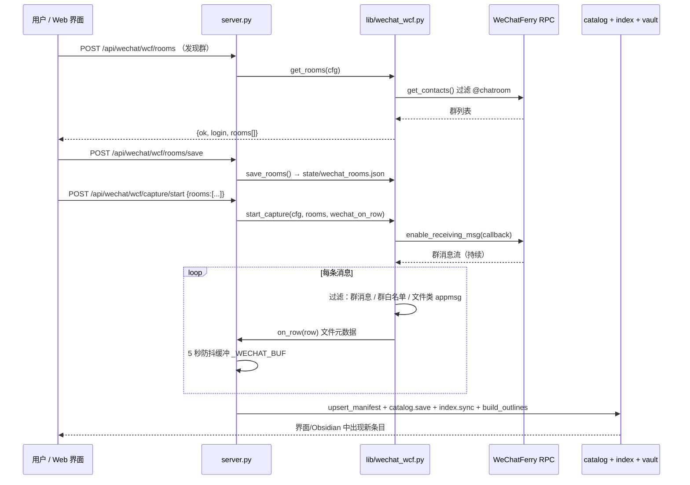

# 新增功能详解：微信群文件监听采集 · 群文件三级自动分类

> 本文面向想理解或二次开发这两个功能的人。只想使用请读根目录 [README.md](../README.md)。
> 实现入口：`lib/wechat_wcf.py`、`lib/classify.py`、`server.py`、`config.json`。
> 版本基线：v2.8.0（微信适配器自 v1.5.0 引入、v1.9.0 加固；分类词库 v2.8.0 修正泛化词）。

---

## 一、微信群文件监听采集

### 1.1 为什么不能像 QQ 那样做

QQ 侧通过 NapCat（OneBot 11）可以调用 `get_group_root_files` / `get_group_files_by_folder` **递归遍历群文件全目录**，拿到完整的云端清单。微信侧完全不同：

| 能力 | QQ（NapCat） | 微信 |
| --- | --- | --- |
| 列出群文件全目录 | ✅ 只读 API | ❌ 无开放接口 |
| 云端未下载文件的元数据 | ✅ 可拿 | ❌ 拿不到 |
| 本地聊天数据库 | 不在方案内 | 加密 SQLite，**不可读、本项目绝不读** |
| 本地 `msg/file/` 已落地文件 | — | 只有文件名/大小/时间，**没有群归属** |
| 协议端 / 机器人 API | ✅ OneBot 11 | ❌ 个人微信无 |

**结论**：在不破解、不读加密库的前提下，微信只能做「**监听式采集**」——订阅开启捕获之后、指定群里新出现的文件/附件消息。历史文件不会被凭空补出来。

### 1.2 方案选型：WeChatFerry

经评估 GitHub 上的成熟方案后选用 [WeChatFerry](https://github.com/lich0821/WeChatFerry)（PyPI: `wcferry`），理由：

- 它在本机对「微信 3.9.x」进程暴露**本地 RPC**，不伪造云端协议、不上传数据；
- 提供 `enable_receiving_msg(callback)` 订阅消息、`get_contacts()` 列群、`download_attachments()` 拉附件，正好覆盖所需能力；
- 属于「用户自己本机已登录微信」的本地能力，符合本项目「纯本地、授权、只读」的边界。

> ⚠️ 微信 4.x 客户端不在支持范围内；`wcferry` 与 WeChatFerry 客户端需用户**自行安装并确认合规**。本项目只做本地适配层，不捆绑、不分发、不默认启用。

### 1.3 数据流



### 1.4 消息过滤规则（代码级）

`lib/wechat_wcf.py::_Capture._cb` 对每条消息依次做四层过滤，任一不通过直接丢弃：

| 顺序 | 判据 | 代码 |
| --- | --- | --- |
| 1 | 必须是群消息 | `msg.from_group` 为真 |
| 2 | 群必须在白名单内 | `msg.roomid ∈ self.rooms`（**白名单非空才启动捕获**） |
| 3 | 必须是文件/附件类消息 | `_is_file_msg()`：XML 含 `appmsg` 且 `<type>` ∈ `{6,5,8}`，或含 `attach` / `file` 关键字 |
| 4 | 能解析出文件名 | `_to_row()`：从 XML `<title>` 取名字，取不到则用 `content` 前 60 字 |

转换为统一目录行时提取的字段：

| 字段 | 来源 |
| --- | --- |
| `source` | 固定 `微信(WeChatFerry)` |
| `group` / `group_id` | `msg.roomid` + 通讯录里的群名映射 |
| `path` / `name` | XML `<title>` |
| `folder` | 固定 `(群文件消息)`（微信无目录层级） |
| `ext` | 文件名后缀小写 |
| `size_bytes` / `size` | `<totallen>` → `<size>` → `<totalsize>` 依次回退 |
| `uploader` | `msg.sender` |
| `file_id` / `busid` | `msg.id` / `0` |
| `local_path` | 空（附件落地由 WeChatFerry 侧负责） |

回调异常被静默吞掉（`except Exception: pass`），**单条坏消息不会打断监听循环**。

### 1.5 群白名单（v1.9.0 安全加固）

早期版本在 `rooms` 为空时会「监听全部群」，存在误采集风险。v1.9.0 改为：

```
start_capture(cfg, rooms, on_row)
  ├─ 校验 enabled / available / login，任一不满足 → 明确报错
  ├─ effective = rooms（请求传入）  若为空 → load_rooms()（已持久化清单）
  ├─ 两者皆空 → 拒绝启动：「未指定监听群：请在请求中传 rooms，或先发现群并保存监听清单」
  └─ save_rooms(effective) → 记住本次选择，重启后无需重选
```

清单存于 `state/wechat_rooms.json`（已 gitignore）。**绝不默认监听全部群**。

### 1.6 状态、端点与配置

| 端点 | 方法 | 说明 |
| --- | --- | --- |
| `/api/wechat/wcf/status` | GET | `enabled` / `available` / `connected` / `login` / `rooms` / `reason` / `mode` |
| `/api/wechat/wcf/rooms` | GET | 仅 `available + login` 时返回群列表 |
| `/api/wechat/wcf/rooms/save` | POST | 保存监听群清单 |
| `/api/wechat/wcf/capture/start` | POST | 启动捕获（可传 `rooms` 覆盖清单） |
| `/api/wechat/wcf/capture/stop` | POST | 停止捕获 |
| `/api/state` | GET | 含 `wechat.wcf` 与 `capturing` 字段 |

配置（`config.json → sources.wechat`）：

| 字段 | 默认 | 说明 |
| --- | --- | --- |
| `enabled` | `false` | 微信总开关 |
| `wcf.enabled` | `false` | 监听适配器开关，**默认关闭** |
| `wcf.host` / `wcf.port` | `127.0.0.1` / `10086` | WeChatFerry RPC 地址 |
| `authorized_local_dir` | `""` | 预留：本地已落地文件授权目录 |

`status()` 在未开启 / 未装 `wcferry` / 未登录 / RPC 连不上四种情况下分别给出**可操作**的 `reason`，界面直接展示。

### 1.7 已知边界

1. **只有开启捕获之后的新消息**，历史群文件无法补采。
2. 采集到的是**元数据**，要正文仍需显式确认下载；微信附件落地由 WeChatFerry 侧决定。
3. 微信没有目录层级，`folder` 统一记为 `(群文件消息)`，三级分类主要靠文件名。
4. 微信 4.x 客户端不支持；`wcferry` 需自行安装。
5. 5 秒防抖意味着极密集的文件消息会被合并成一次落库（有意为之，避免频繁全量写）。

---

## 二、群文件三级自动分类

### 2.1 目标

群文件只有「文件名 + 所在文件夹」可用。分类器要在**不读文件内容**的前提下，把每条元数据归到：

```
领域 domain  →  科目 / 主题 subject  →  资源类型 kind
```

全部规则外置在 `config.json → classification`，**改词库不用改代码**。

### 2.2 词库规模

| 层级 | 数量 | 示例 |
| --- | --- | --- |
| `domains` | 6 | 学习、考试与复习、科研与论文、证书与竞赛、实习与就业、生活与办事 |
| `subjects` | 24（含兜底「综合」） | 高等数学、复变函数与积分变换、高等代数、数学分析、离散数学、数据结构、C语言程序设计… |
| `kinds` | 6 | 试卷与解析、习题作业、课件资源、上课笔记、实验代码、指南说明 |

### 2.3 打分算法

`lib/classify.py::classify(row, cfg)` 中 `_hits(text, keywords)` 返回关键词在文本中的命中个数（大小写不敏感的子串匹配），拼接 `hay = folder + " " + name` 后分别加权：

| 层级 | 权重公式 | 兜底 |
| --- | --- | --- |
| `subject` | `3 × hits(folder) + 2 × hits(name)` | `综合` |
| `kind` | `2 × hits(folder) + 1 × hits(name)` | `其他资料` |
| `domain` | `2 × hits(folder) + 1 × hits(name)` | `其他`；若 `domain == 其他` 且（`subject != 综合` 或 `kind ∈ {课件资源, 习题作业, 上课笔记}`）→ 修正为 `学习` |

每层取**最高分**标签；同分时保留词库中先出现的（因此词库顺序有意义）。

**为什么文件夹权重更高**：群里通常已经按「考试与复习 / 课件 / 作业」分好目录，文件夹名比文件名更可信；文件名主要用于在同目录内区分科目与具体类型。

### 2.4 实测样例（v2.8.0 词库）

| 输入（文件夹 / 文件名） | 领域 | 科目 | 类型 |
| --- | --- | --- | --- |
| `考试与复习` / `高等数学期末真题.pdf` | 考试与复习 | 高等数学 | 试卷与解析 |
| `课件` / `复变函数与积分变换讲义.pdf` | 学习 | 复变函数与积分变换 | 课件资源 |
| — / `线性代数课后习题答案.docx` | 学习 | 线性代数 | 习题作业 |
| — / `数据结构实验代码.zip` | 学习 | 数据结构 | 实验代码 |
| — / `大学物理知识点总结.md` | 学习 | 大学物理 | 上课笔记 |
| — / `C语言程序设计上机指南.txt` | 学习 | C语言程序设计 | 实验代码 |
| — / `2024年校招简历模板.docx` | 实习与就业 | 综合 | 其他资料 |
| — / `宿舍水电缴费指南.pdf` | 生活与办事 | 综合 | 指南说明 |

### 2.5 v2.8.0 修复：泛化词导致的领域误判

全版本审计的专项功能探测 + 真实样例回归发现：`生活与办事` 词库里的**裸词 `指南`**（以及 `活动`、`校园`）过于宽泛，会把 `C语言程序设计上机指南.txt` 这类明显的学习资料判成「生活与办事」（`指南` 命中 +1 分，而学习类关键词 0 分）。

**修复方式**：只改数据、不改算法——把泛化词替换为具体短语：

```diff
- "生活与办事": ["宿舍","水电","缴费","入学","指南","社团","活动", ... ,"校园", ...]
+ "生活与办事": ["宿舍","水电","缴费","入学","入学指南","办事指南",
+                "新生指南","报到指南","社团","迎新","办事","校园通", ...]
```

修复后：`C语言程序设计上机指南.txt → 学习`（走科目兜底），`宿舍水电缴费指南.pdf → 生活与办事`（由 `宿舍/水电/缴费` 命中），`新生入学指南.pdf → 生活与办事`。

回归断言已加入 `tools/smoke_test.py` 的 `[15]`，锁住「学习 / 生活与办事 / 实习与就业」三类不得互相串味。`tools/version_audit.py` 的 `FEATURE_PROBE` 也会用 6 个代表性文件名验证每个历史版本的科目词库是否失效。

### 2.6 自定义词库

1. 打开 `config.json → classification`。
2. 在 `domains` / `subjects` / `kinds` 里增删条目；每条是 `{name, keywords}` 或 `科目名: [关键词...]`。
3. 保存后启动服务，点「刷新来源」重新归类（`catalog.upsert_manifest()` 会重算分类，但保留 `downloaded / note / asset / summary`）。
4. 用 `python tools/smoke_test.py` 确认 `FEATURE_PROBE` 仍通过。

> 建议：避免把「指南」「资料」「文件」这类**跨领域通用词**放进领域词库，它们更适合放在 `kinds`。关键词尽量用 2 字以上的具体短语。

### 2.7 分类结果流向

| 消费方 | 用法 |
| --- | --- |
| `catalog.tree()` | 按 `领域 → 科目 → 类型` 聚合分类树，界面左栏逐级下钻；`dim=source` 可切「来源 → 群 → 文件夹」 |
| `catalog.query()` | 节点过滤 + `q` 全文匹配（含 domain / subject / kind / summary） |
| `ai._filters()` / `_scope_from_path()` | 从问题文本与当前浏览路径识别科目/领域/类型，合并成检索过滤器，**严格限定范围** |
| `vault.build_outlines()` | 生成总览、全量多级大纲、每个层级一页 MOC、单文件预览笔记 |
| `index._meta_str()` | 把 domain / subject / kind 写进 FTS5 的 `meta` 列，参与全文检索打分 |

---

## 三、相关代码索引

| 功能 | 文件 / 函数 |
| --- | --- |
| 微信适配器状态、群清单、启停 | `lib/wechat_wcf.py` — `status` / `get_rooms` / `load_rooms` / `save_rooms` / `start_capture` / `stop_capture` |
| 消息过滤与行转换 | `lib/wechat_wcf.py::_Capture._is_file_msg` / `_to_row` / `_cb` |
| 服务端防抖与入库 | `server.py::wechat_on_row` / `wechat_flush` |
| 三级分类 | `lib/classify.py::classify` / `_hits` |
| 词库 | `config.json → classification` |
| 目录合并（保留下载状态） | `lib/catalog.py::upsert_manifest` |
| 分类树 / 过滤 | `lib/catalog.py::tree` / `query` / `_matches` |
| 回归自测 | `tools/smoke_test.py`（分类 `[15]`、微信清单 `[8]`） |
| 全版本功能探测 | `tools/version_audit.py::FEATURE_PROBE` |
